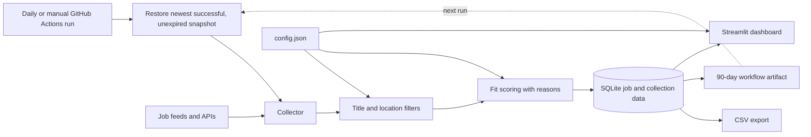

# Remote Job Market Tracker

Remote Job Market Tracker collects remote job listings, filters them against a
candidate profile, scores fit with visible reasons, and presents the results
and hiring trends in a Streamlit dashboard. The profile and filter rules are
configured in [`config.json`](./config.json).

## What it does

- Collects listings from Remotive, Jobicy, Remote OK, and configured We Work
  Remotely RSS feeds.
- Filters roles by configured title terms and location restrictions.
- Scores matching roles using skills, role fit, location, and seniority, with
  explanations shown for each score.
- Saves listings and application statuses in SQLite, and exports a CSV copy.
- Shows the latest fetched, matched, and new listing counts per source, as well
  as skill and hiring-trend summaries.
- Runs lint and tests on pushes and pull requests. GitHub Actions also collects
  jobs daily at 06:00 UTC, with a manual workflow option.
- Restores data from the newest successful run with an unexpired snapshot;
  snapshots are retained for 90 days, and a fresh database is used if none
  remain.

## Architecture



## Local setup

Requires Python 3.11 or newer.

```bash
python -m venv .venv
source .venv/bin/activate
python -m pip install -e ".[dev]"
```

Collect and score listings, then start the dashboard:

```bash
python collector.py
streamlit run app.py
```

Open the local Streamlit URL shown in the terminal (normally
`http://localhost:8501`). The collector writes `jobs.db` and `jobs.csv` into the
project directory by default. Set `JOB_TRACKER_DATA_DIR` to use another data
directory:

```bash
JOB_TRACKER_DATA_DIR=/path/to/tracker-data python collector.py
JOB_TRACKER_DATA_DIR=/path/to/tracker-data streamlit run app.py
```

Run the checks locally with:

```bash
ruff check src tests app.py collector.py
pytest -q
```

## Run with Docker

Docker Compose builds the app and persists its data in the named
`tracker-data` volume:

```bash
docker compose up --build -d
```

Open `http://localhost:8501`. Stop the app while keeping the stored data with
`docker compose down`; `docker compose down -v` also removes the data volume.

## Dashboard screenshots

Add screenshots here after collecting listings and opening the dashboard.

<!-- Add dashboard screenshots below. -->

## Example insights

These are examples of the kinds of observations the dashboard can support,
not claims about a particular collection:

- Compare fetched, matched, and new counts to see whether a source returned no
  listings or returned listings that did not pass the filters.
- Compare skill counts to identify which configured skills appear most often
  among the currently eligible listings.
- Use the location-eligible share and daily listing chart to compare location
  fit and new-listing volume over time.

## What I learned

- How to normalize and combine job data from APIs and RSS feeds.
- How to explain a job-fit score instead of presenting it as an unexplained
  ranking.
- How to preserve SQLite data across short-lived GitHub Actions runners with
  workflow artifacts.
- How to use Docker Compose volumes for persistent local application data.
